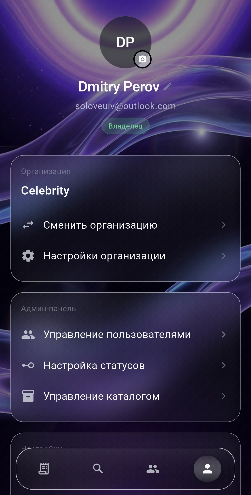
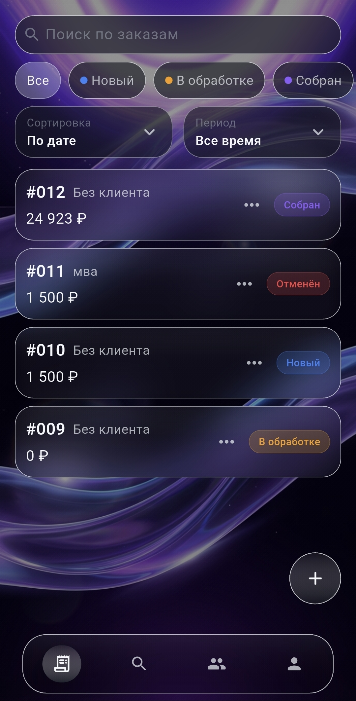
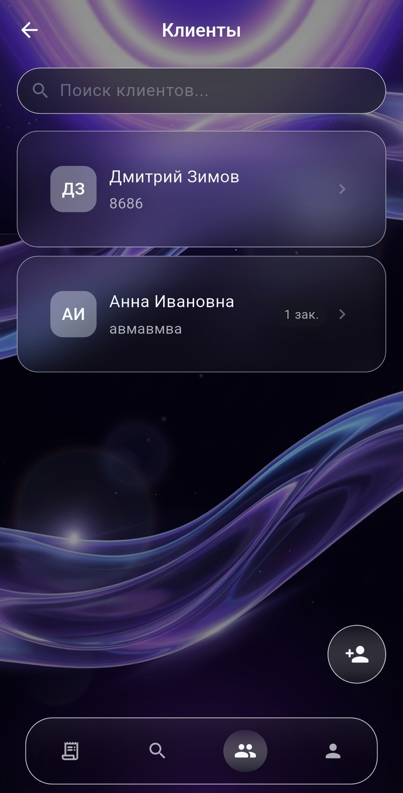
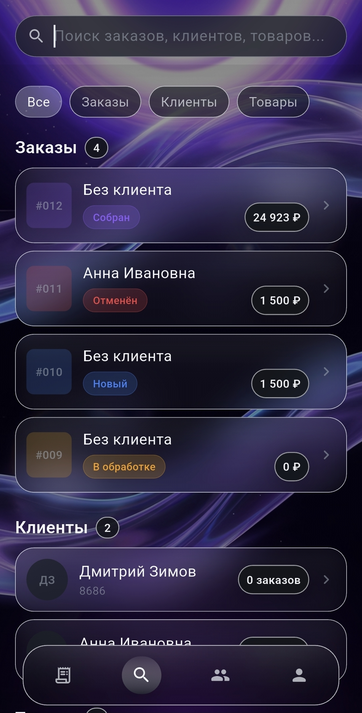

# Deskflow

> Мобильная CRM-система для e-commerce команд с контекстным чатом внутри каждого заказа.

Deskflow объединяет заказы, клиентов, каталог товаров, уведомления и рабочие обсуждения в одном Flutter-приложении. Проект построен на Supabase, использует multi-org модель с изоляцией данных через RLS и поддерживает роли `Owner`, `Admin`, `Member`.

> [!NOTE]
> Письма с кодом для подтверждения почты могут уходить в спам.

## Overview

Deskflow рассчитан на команды интернет-магазинов, где работа с заказом включает не только статус и состав, но и постоянную коммуникацию. Приложение собирает в одном месте CRM-данные, чат по заказу, каталог товаров, клиентскую базу, уведомления и организационные настройки.

Ключевой акцент проекта:

- единый рабочий поток вокруг заказа
- контекстный realtime-чат внутри заказа
- multi-account и multi-organization сценарии
- role-based access для командной работы
- визуальный стиль Liquid Glass

## Core Features

### Orders

- список заказов с пагинацией и фильтрами
- карточка заказа с клиентом, суммой, доставкой, заметками и позициями
- создание заказа через атомарную RPC-функцию `create_order_with_items`
- редактирование, дублирование заказов и шаблоны заказов
- кастомный pipeline статусов
- журнал событий и смен статуса

### Chat

- realtime-чат внутри заказа
- вложения в приватном Storage bucket и предпросмотр файлов
- системные сообщения для событий заказа
- optimistic UI для отправки сообщений

### Customers and Products

- клиентская база с карточками и историей заказов
- каталог товаров с поиском и статусами
- CRUD-операции для ролей с нужным уровнем доступа

### Organizations and Access

- создание и выбор организации
- вход по invite-коду
- email-приглашения в организацию
- роли `Owner`, `Admin`, `Member`
- изоляция данных между организациями на уровне PostgreSQL RLS

### Search and Notifications

- универсальный поиск по заказам, клиентам и товарам
- история поиска
- in-app уведомления по заказам, сообщениям и статусам

## Tech Stack

- Flutter 3
- Dart 3.10
- Riverpod, Flutter Hooks, Riverpod Generator
- GoRouter
- Supabase Auth, PostgreSQL, Realtime, Storage
- `flutter_secure_storage` для refresh-токенов
- SharedPreferences для не-секретных локальных настроек
- logger, intl, uuid, image_picker, file_picker, cached_network_image

## Architecture

Проект организован по подходу feature-first MVVM. Общая инфраструктура и UI-kit находятся в `lib/core`, а прикладная логика разбита по фичам в `lib/features`.

Базовая структура:

```text
lib/
  core/
    config/
    constants/
    errors/
    models/
    providers/
    router/
    theme/
    utils/
    widgets/
  features/
    admin/
    auth/
    chat/
    customers/
    notifications/
    orders/
    org/
    products/
    profile/
    search/
  main.dart
supabase/
  migrations/
test/
docs/
```

Внутри каждой feature используются слои:

```text
feature/
  data/
  domain/
  presentation/
```

Архитектурные принципы:

- `presentation` работает через providers и domain-модели
- `data` инкапсулирует доступ к Supabase
- общие виджеты, тема, ошибки и утилиты вынесены в `core`
- навигация построена через GoRouter
- безопасность и границы доступа опираются на RLS-политики в базе

## UI and Screenshots

Проект использует визуальный стиль Liquid Glass с акцентом на тёмный фон, glassmorphism-элементы, pill-кнопки и floating island navigation.

<p align="center">
  
  
</p>
<p align="center">
  
  
</p>

## Environment Setup

Проект использует runtime-конфигурацию через `assets/env.json`.

Создайте файл на основе шаблона:

```bash
copy env.example.json assets/env.json
```

Заполните в `assets/env.json` следующие поля:

- `SUPABASE_URL`
- `SUPABASE_ANON_KEY`
- `GOOGLE_WEB_CLIENT_ID`
- `GOOGLE_IOS_CLIENT_ID`

Файл `assets/env.json` игнорируется Git и не должен попадать в репозиторий. Также поддерживается запуск через `--dart-define`, но основной сценарий проекта рассчитан на `assets/env.json`.

## Run

Установка зависимостей:

```bash
flutter pub get
```

Запуск приложения:

```bash
flutter run
```

Запуск на конкретной платформе:

```bash
flutter run -d chrome
flutter run -d windows
flutter run -d android
```

## Code Generation

Riverpod generator и другие generated-файлы не коммитятся, поэтому перед analyze/test нужно выполнить генерацию:

```bash
dart run build_runner build --delete-conflicting-outputs
```

Для режима наблюдения:

```bash
dart run build_runner watch --delete-conflicting-outputs
```

## Testing

Запуск всех тестов:

```bash
flutter test
```

Запуск конкретного файла тестов:

```bash
flutter test test/features/orders/data/order_repository_test.dart
```

В проекте есть unit, widget и integration tests для ключевых сценариев.

## Backend

Backend-часть проекта построена на Supabase:

- PostgreSQL как основная база данных
- RLS для multi-org изоляции
- Realtime для чатов и live-обновлений
- Storage для вложений и изображений
- SQL migrations в `supabase/migrations`

### Applying migrations

Примените миграции из `supabase/migrations` в порядке timestamp (имена файлов отсортированы лексикографически). Проще всего:

```bash
supabase db push
```

или последовательное выполнение SQL-файлов в Supabase SQL Editor. Не применяйте файлы выборочно: более поздние миграции заменяют политики и функции из ранних.

### RLS coverage

Базовая схема (`20260216121736_full_schema.sql`) включает RLS для основных таблиц:

- `organizations`, `organization_members`
- `profiles`
- `order_statuses`, `customers`, `orders`, `products`, `order_items`
- `audit_events`
- `chat_messages`, `chat_attachments`

Политики привязаны к членству в организации. Последующие миграции добавляют такой же org-scoped подход для поиска, уведомлений, preferences, invites и order templates. Storage-политики закрывают `product-images`, `org-avatars`, `avatars`; отдельная cleanup-миграция делает `chat-attachments` приватным и разрешает чтение/запись только участникам организации заказа.

RLS применяется на стороне PostgreSQL. Клиентское приложение не должно считаться источником авторизации.

## Development Process

Проект разрабатывался AI-assisted workflow:

- архитектура, продуктовые решения, приоритеты и финальное ревью — Ivan Shanev
- генерация кода, рефакторинги, тесты и документация — с помощью Claude Code и агентов
- каждая итерация проходила ручное ревью перед включением в проект

Это не autogenerated dump: PR-структура и итоговые решения формировались вручную.

## Known Limitations

- Некоторые presentation-файлы остались крупными монолитами и требуют декомпозиции: `orders_list_screen.dart` (~1980 строк), `order_chat_screen.dart` (~1180), `create_order_screen.dart` (~1130), `universal_search_screen.dart` (~1020), `profile_screen.dart` (~850).
- Атомарная вставка реализована для создания заказа (`create_order_with_items`). Изменение статуса/заказа и запись audit event по-прежнему выполняются отдельными запросами и не составляют единую транзакцию.
- URL вложений чата подписываются при отправке и хранятся со сроком действия один год. После истечения URL нужен отдельный flow обновления подписи; сейчас историческое вложение может стать недоступным.
- Миграции нужно применить к своему Supabase-проекту вручную или через Supabase CLI. История миграций нормализована: при пересекающихся темах выбраны более поздние GitHub-версии, donor-дубликаты не дублируются.
- Тесты покрывают ключевые репозитории, модели и экраны, но не всю поверхность UI; крупные монолиты — первоочередной рефакторинг.
- `pubspec.lock` нужно обновить командой `flutter pub get` после добавления `flutter_secure_storage`; CI делает это перед codegen и тестами.

## License

Проект распространяется по лицензии [MIT](LICENSE).
